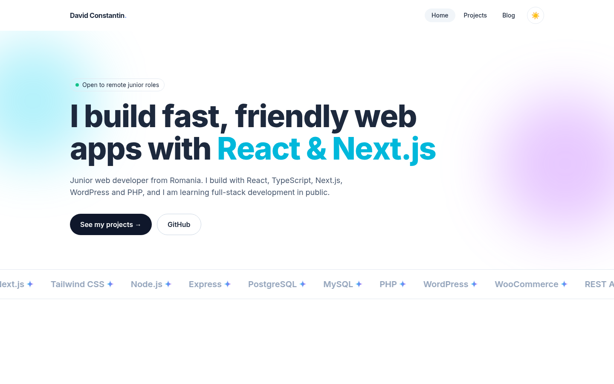
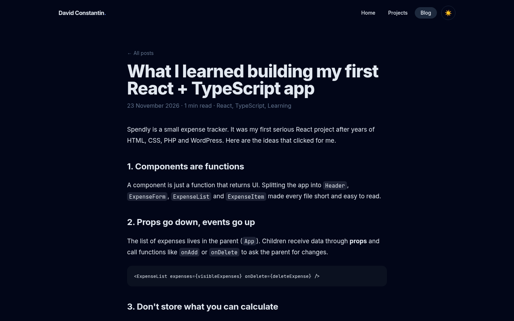
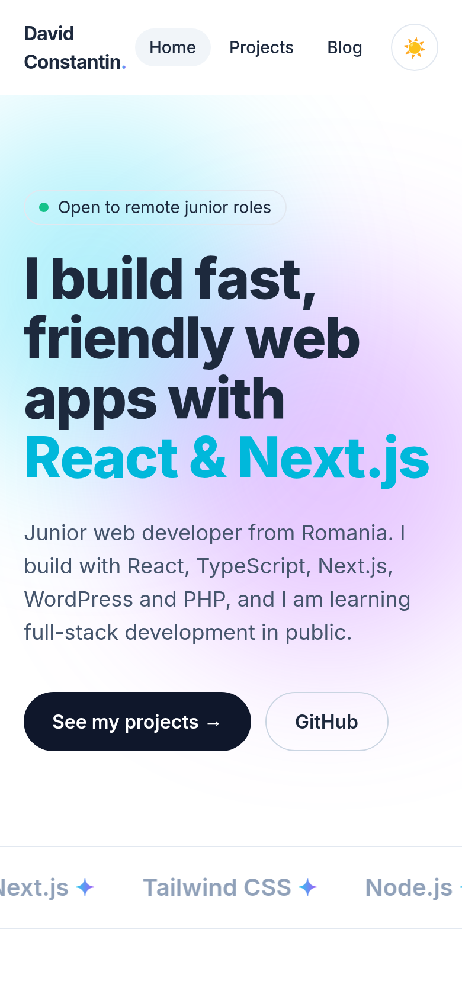

# Portfolio & Blog — Next.js

My personal portfolio and blog, built with **Next.js (App Router)**, **TypeScript**, **Tailwind CSS v4**, **Motion** and **GSAP**.
It is exported as a fully static site and hosted for free on GitHub Pages.

> Learning project #3 in my roadmap (React → Next.js → Node → full-stack).

**Live:** https://davidgeorgeconstantin-spec.github.io/nextjs-portfolio/

| Home | Blog post (dark mode) | Mobile |
|---|---|---|
|  |  |  |

## Features

- **App Router** pages: Home, Projects, Blog, Blog post (`/blog/[slug]`), custom 404
- **Markdown blog**: posts are `.md` files with front matter, parsed at build time (`gray-matter` + `marked`) in Server Components
- **Static export** (`output: 'export'`, `basePath: '/nextjs-portfolio'`) and `generateStaticParams` for every post
- **SEO**: per-page metadata, Open Graph tags, `sitemap.xml` and `robots.txt` generated by Next.js
- **Dark mode** with no flash (inline script + `localStorage` + system preference)
- Responsive, accessible navigation

### Animations

| Effect | Library |
|---|---|
| Hero title split into characters and animated in a wave | GSAP `SplitText` + timeline |
| Floating gradient blobs | GSAP (yoyo, infinite) |
| Roadmap line that fills while scrolling (scrub) | GSAP `ScrollTrigger` |
| Shared-layout nav pill, hide-on-scroll header | Motion `layoutId`, `useScroll` |
| 3D tilt + mouse spotlight project cards | Motion `useMotionValue`, `useSpring`, `useMotionTemplate` |
| Magnetic buttons | Motion springs |
| Staggered scroll reveals | Motion `whileInView` |
| Reading progress bar on posts | Motion `useScroll` + `useSpring` |
| Infinite skills marquee | CSS keyframes (pauses on hover) |

All animations respect **`prefers-reduced-motion`** (`MotionConfig reducedMotion="user"` and `gsap.matchMedia()`).

## Tech stack

Next.js 15 · React 19 · TypeScript (strict) · Tailwind CSS 4 · Motion · GSAP · gray-matter · marked · ESLint · GitHub Actions

## Project structure

```
src/
├── app/                      # routes (App Router)
│   ├── layout.tsx            # fonts, metadata, theme script, header/footer
│   ├── page.tsx              # home
│   ├── projects/page.tsx
│   ├── blog/page.tsx
│   ├── blog/[slug]/page.tsx  # static post pages
│   ├── sitemap.ts, robots.ts, not-found.tsx
│   └── globals.css           # Tailwind + post typography
├── components/
│   ├── layout/               # SiteHeader, SiteFooter
│   ├── sections/             # Hero, SkillsMarquee, ProjectsGrid, RoadmapTimeline, ContactSection
│   ├── motion/               # MotionProvider, Reveal, ReadingProgress
│   └── ui/                   # ProjectCard, PostCard, MagneticButton, ThemeToggle, SectionHeading
├── content/
│   ├── posts/*.md            # blog posts
│   └── projects.ts           # roadmap data
├── lib/                      # posts.ts (Markdown), gsap.ts, site.ts, paths.ts
└── types/content.ts
```

## Getting started

```bash
npm install
npm run dev     # http://localhost:3000/nextjs-portfolio
npm run lint
npm run build   # static site in out/
```

Add a post: create `src/content/posts/my-post.md` with `title`, `date`, `summary` and `tags` in the front matter.

## Deployment

`.github/workflows/deploy.yml` builds the site and publishes `out/` to GitHub Pages
(Settings → Pages → Source: **GitHub Actions**). If you rename the repo, change `basePath` in `next.config.ts`.

## Author

**David Constantin** · [GitHub](https://github.com/davidgeorgeconstantin-spec)
